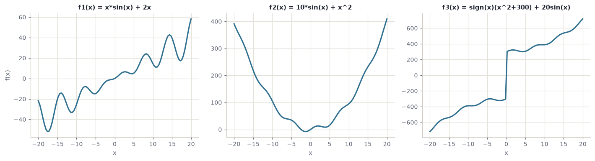
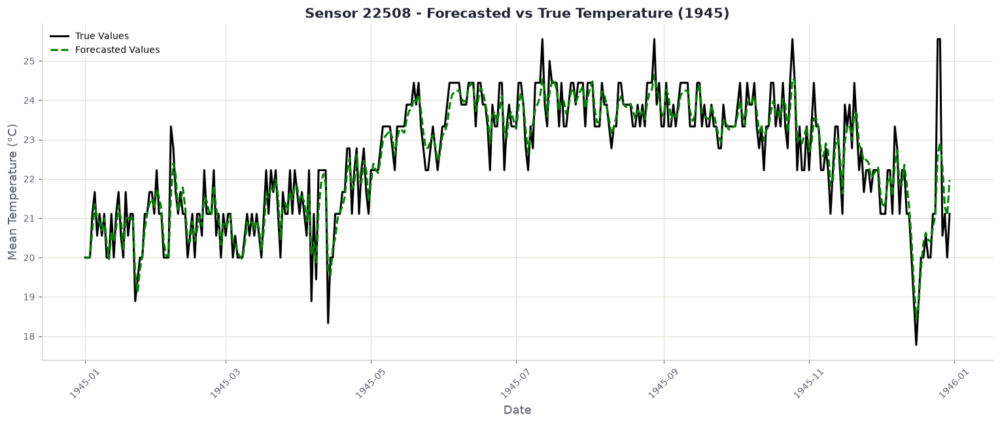

```{=html}
<div class="stage">

<header class="hero">
  <div class="hero-inner">
    <p class="kicker">Regression, tested to destruction</p>
    <h1>A perfect score<br>is a warning</h1>
    <p class="standfirst">
      One model fits this curve exactly. R&nbsp;squared of 1.000, nothing left
      over. It is also the first model to fall apart, and it falls further than
      anything else here: all the way to &minus;24.4.
    </p>
    <p class="source-line">
      Every number on this page comes out of one notebook.
      <a href="https://github.com/O-2wice/regression-benchmark-and-forecasting/blob/main/notebooks/regression-benchmark-and-forecasting.ipynb">Read it on GitHub</a>
      <span class="sep">&middot;</span>
      <a href="https://colab.research.google.com/github/O-2wice/regression-benchmark-and-forecasting/blob/main/notebooks/regression-benchmark-and-forecasting.ipynb">open it in Colab</a>
    </p>
    <div class="scroll-hint">scroll to add noise <span>&darr;</span></div>
  </div>
</header>

<!-- ------------------------------------------------------------------ -->
<!-- scroll-driven: the chart stays, the noise rises, the text explains  -->
<!-- ------------------------------------------------------------------ -->
<section class="scrolly" id="scrolly">
  <div class="scrolly-sticky">
    <div class="viz-head">
      <span class="viz-title">f(x) = x&middot;sin(x) + 2x</span>
      <span class="viz-noise">noise &sigma; = <b id="sigma-out">0</b></span>
    </div>
    <svg id="viz" viewBox="0 0 620 360" preserveAspectRatio="xMidYMid meet"></svg>
    <div class="scoreboard" id="scores"></div>
  </div>

  <div class="scrolly-steps">
    <div class="step" data-level="0">
      <h2>Start with a function you wrote</h2>
      <p>
        Every point here comes from <code>x·sin(x) + 2x</code>. Because the
        formula is known, there is a correct answer at every position, and a
        model can be marked against it rather than against opinion.
      </p>
      <p>
        Four models are fitted. Each gets the same five columns as input:
        <code>x</code>, <code>sin x</code>, <code>cos x</code>,
        <code>x²</code>, <code>x³</code>. Nobody told them the formula, only
        that the shape looks periodic and polynomial.
      </p>
      <p class="aside">
        <b>R squared</b> is the share of the variation a model accounts for.
        1.000 is exact. 0.000 means it does no better than always guessing the
        average and ignoring <code>x</code> completely. Below zero means it
        does worse than that.
      </p>
    </div>

    <div class="step" data-level="1">
      <h2>At zero noise, two models are perfect</h2>
      <p>
        Polynomial regression and ridge both hit <b>1.000</b>. Given
        <code>sin x</code> as a column, <code>x·sin(x) + 2x</code> is just a
        weighted sum of the inputs, so the model does not need to approximate
        anything. It solves for four numbers and lands on the curve.
      </p>
      <p>
        Plain linear regression manages <b>0.888</b> without ever bending. It
        is fitting the upward drift and ignoring every wave, and on this
        function the drift alone is most of the story.
      </p>
    </div>

    <div class="step" data-level="2">
      <h2>Now add a little noise</h2>
      <p>
        Each target gets a random nudge drawn from a normal distribution. At
        &sigma;&nbsp;=&nbsp;5 the curve is still obvious to the eye, and the
        polynomial has already dropped from 1.000 to <b>0.481</b>.
      </p>
      <p>
        Nothing about the underlying function changed. What changed is that the
        points no longer sit exactly on it, and a model with enough freedom to
        pass through every point will use that freedom.
      </p>
    </div>

    <div class="step" data-level="4">
      <h2>The perfect model goes negative</h2>
      <p>
        By &sigma;&nbsp;=&nbsp;20 the polynomial is at <b>&minus;8.4</b>. It is
        not merely inaccurate. It is worse than refusing to model the data at
        all and drawing a flat line through the average.
      </p>
      <p>
        This is <b>overfitting</b>, and the chart shows the mechanism rather
        than the definition: the curve is chasing individual points. Those
        points contain noise, so the shape it learns is partly the shape of the
        randomness, which will be different next time.
      </p>
    </div>

    <div class="step" data-level="6">
      <h2>The unimpressive models survive</h2>
      <p>
        At &sigma;&nbsp;=&nbsp;75 everything has degraded, because at this
        point the noise is larger than much of the signal. But look at the
        spread: linear sits near <b>&minus;0.78</b> and the polynomial is at
        <b>&minus;24.4</b>, roughly thirty times worse.
      </p>
      <p>
        Ridge is the same polynomial with one change: large coefficients are
        penalised. That single constraint is the difference between a model
        that bends toward every point and one that cannot afford to.
      </p>
      <p class="aside">
        <b>Regularisation</b> adds the size of the coefficients to the thing
        being minimised. The model must now trade accuracy against complexity,
        so it only buys a bend when the data really pays for it.
      </p>
    </div>

    <div class="step" data-level="7">
      <h2>What the slider is really showing</h2>
      <p>
        The ranking at zero noise is the opposite of the ranking under noise.
        If you picked a model by its score on clean data, you picked the one
        that fails hardest the moment reality intrudes.
      </p>
      <p>
        That is the whole argument, and it is why the rest of this project
        keeps taking guarantees away: correlated inputs next, then useless
        inputs, then real weather where there is no formula to recover at all.
      </p>
    </div>
  </div>
</section>
</div>
```

::: {.body}


## First, what a regression model actually does

Skip this if it is familiar. If it is not, everything below depends on it.

You have pairs of numbers. An input, call it $x$, and an output, $y$. A
**regression model** is a rule for guessing $y$ when you are handed a new $x$
you have not seen before. Fitting the model means searching for the rule that
comes closest to the pairs you already have.

The simplest rule is a straight line: pick a slope and a height, and the model
is fixed. **Linear regression** does exactly that, choosing the line whose total
squared distance from the points is smallest. It is the whole method.

Other models allow other shapes:

- **Polynomial regression** is still a straight-line fit, but on invented
  columns. Give it $x$, $x^2$ and $x^3$ as separate inputs and the resulting
  "line" bends, because it is a line in a space you built.
- **Random forest** does not draw any curve. It repeatedly splits the input
  range into regions and predicts the average of each region, so its output
  looks like a staircase rather than a curve.
- **SVR** fits a smooth surface but only penalises predictions that miss by
  more than a set tolerance, so small errors cost it nothing.

::: {.term}
**Two numbers are used to mark them.** **MSE** is the average squared error:
lower is better, and squaring means one large miss hurts more than several
small ones. **R squared** rescales that into a share: 1.000 means the model
accounts for all the variation, 0.000 means it does no better than ignoring
$x$ entirely and always answering with the average, and a negative value means
it does worse than that. Negative is not a rounding problem. It is a model you
would be better off deleting.
:::

## Three shapes, and the one that humiliates a straight line

The study names three functions. They look similar on paper and behave nothing
alike.

$$f_1(x) = x \sin(x) + 2x \qquad f_2(x) = 10 \sin(x) + x^2 \qquad f_3(x) = \operatorname{sign}(x)(x^2 + 300) + 20 \sin(x)$$

{#fig-three}

Fitted on raw $x$ alone, with no engineered columns, they separate the models
sharply:

| Function | Linear | Poly (3) | Forest | SVR |
| --- | ---: | ---: | ---: | ---: |
| $f_1$, a rising wave | 0.892 | 0.891 | **0.987** | 0.885 |
| $f_2$, a rippled parabola | [**−0.019**]{.down} | 0.996 | 0.996 | 0.995 |
| $f_3$, a parabola with a jump | 0.932 | 0.945 | **1.000** | 0.973 |

Look at linear regression. On $f_1$ it manages a respectable 0.892. On $f_2$ it
scores **below zero**, which is the worst result any model records on clean
data anywhere in this project.

The reason is worth sitting with, because the usual explanation is wrong. It is
not that $f_2$ is "too non-linear". $f_1$ is non-linear too and the line did
fine there. The difference is **symmetry**. $f_1$ contains $2x$, a steady climb
that a line can follow. $f_2$ is a parabola centred on zero: it falls, then
rises by the same amount. The best straight line through it is flat, and a flat
line is precisely the "always guess the average" baseline that R squared scores
as zero.

::: {.term}
**The transferable lesson.** Linear regression does not fail when a
relationship is curved. It fails when the relationship has no consistent
direction. Check whether $y$ trends with $x$ overall before assuming a line is
a reasonable starting point.
:::

And $f_3$ shows the reverse. It contains a jump at the origin, a vertical cliff
that no smooth curve can reproduce, yet random forest scores a perfect
**1.000** on it. A staircase model finds a step trivial, because stepping is
all it does. The shape that is hardest for every equation-shaped model is the
easiest one here.

## Why build data you already understand

A real dataset cannot tell you whether a model is right. It can only tell you
whether the model agrees with the labels you happen to have, and if those
labels are wrong or incomplete, agreement is worthless.

Synthetic data removes that problem by construction. Each function above is
sampled at 100 points across $[-20, 20]$ and split 70/30 at a fixed seed. The
point is not that these curves are interesting. The point is that when a model
gets one wrong, you can prove it.

The rest of this page follows $f_1$, because it is the shape the noise and
feature-engineering experiments were run against.

## Handing the model what you already know

The models never see the formula. They see engineered columns: $x$, $\sin x$,
$\cos x$, $x^2$, $x^3$. That choice came from looking at a plot and noticing
the curve was both wavy and rising.

It changes everything, and the table shows how unevenly:

| Model | before | after | change |
| --- | ---: | ---: | ---: |
| Polynomial (deg 3) | 0.891 | **1.000** | [+0.109]{.up} |
| SVR (RBF) | 0.885 | 1.000 | [+0.115]{.up} |
| Random Forest | 0.987 | 0.986 | [−0.001]{.down} |
| Linear Regression | 0.892 | 0.888 | [−0.004]{.down} |

The five columns are built by one function, and it never sees $f_1$:

```python
def create_features(x):
    return np.column_stack([
        x,
        np.sin(x),
        np.cos(x),
        x**2,
        x**3
    ])
```

That restraint is the point. `np.sin(x)` is a guess drawn from looking at a
plot, not a copy of the answer. A function that returned `x * np.sin(x) + 2 * x`
would score 1.000 too and would have proved nothing.

Feature engineering did not make anything smarter. It rewrote the question.
"Approximate this curve" became "find four coefficients", and the second
question has an exact answer. Random forest gained nothing because it was
never asking the first question: it slices the input into regions and averages
inside them, so a wavy curve costs it no more than a straight one.

{#fig-importance}


::: {.term}
**Why the inputs are scaled first.** The engineered columns are wildly
different sizes: at $x = 20$ the $x^3$ column is 8,000 while $\sin x$ never
leaves $[-1, 1]$. Ridge penalises large coefficients, and SVR measures distance
between points, so both would be dominated by whichever column happens to carry
the biggest numbers. `StandardScaler` puts every column on the same footing
first. Random forest needs none of this, because a threshold split does not
care what units it is splitting.
:::

## Correlated inputs break the linear models

The second dataset is multivariate: 2,000 samples from `make_regression`, then
deliberately spoiled by making features carry overlapping information.

| Model | R² base | correlated | MSE base | MSE correlated |
| --- | ---: | ---: | ---: | ---: |
| Linear Regression | 0.985 | [−0.013]{.down} | 415.03 | 97.52 |
| Polynomial (deg 2) | 0.984 | [−0.049]{.down} | 442.00 | 101.02 |
| Random Forest | 0.916 | [−0.046]{.down} | 2325.69 | 100.65 |
| SVR (RBF) | 0.954 | [−1.339]{.down} | 1280.71 | 225.11 |

The correlation is not simulated by hand. `make_low_rank_matrix` produces ten
columns that genuinely contain fewer than ten independent directions:

```python
X_corr = make_low_rank_matrix(
    n_samples=2000, n_features=10,
    effective_rank=5, tail_strength=0.5, random_state=SEED
)
weights = np.random.RandomState(SEED).randn(5)
noise   = np.random.RandomState(SEED).normal(0, 10, size=2000)
y_corr  = X_corr[:, :5] @ weights + noise
```

Only the first five columns drive the target. The other five are along for the
ride, and they overlap with the first five because the matrix has rank 5.

There is a trap in this table. The mean squared error **improved** for every
model while R² collapsed. Both are correct. The correlated target has far less
variance, so smaller errors are easier to achieve and explaining the remaining
variation is harder. A single metric would have told you the opposite story.

::: {.term}
**Multicollinearity.** Ordinary least squares solves for one coefficient per
input, assuming each contributes something distinct. When two columns say
nearly the same thing, there is no unique way to divide the credit between
them. The fit stays good; the coefficients become unstable and stop meaning
anything, and small changes in the data swing them wildly.
:::


## What a model does with features that mean nothing

The brief asks for something sharper than a score here: build a dataset where
some inputs are known to be pure noise, fit a linear regressor, and read the
coefficients it learned for them.

The useless columns are drawn from a normal distribution and glued on beside
the real ones, so nothing distinguishes them except that they carry no signal:

```python
def create_harder_features(x, n_non_informative=5):
    base_features = np.column_stack([
        x, x * np.sin(x), np.sin(x), np.cos(x), x**2, x**3
    ])
    non_informative = np.random.randn(len(x), n_non_informative)
    return np.hstack([base_features, non_informative])

X_enhanced = create_harder_features(X_base, n_non_informative=10)
```

With strong target noise and ten uninformative columns added, linear regression
manages **R² 0.082** with an MSE of 1845.6. Barely above useless. The
coefficients explain why:

| Feature | Coefficient |
| --- | ---: |
| 1 | 55.979 |
| 2 | 9.210 |
| 3 | 8.187 |
| 4 | 1.565 |
| 5 | 1.643 |
| 6 | [−32.460]{.down} |
| 7 | 1.599 |

The expectation is that informative features get large weights and noise
features get roughly zero. That is not what happened. Feature 6 carries no
signal and was handed a coefficient of −32.5, comparable in size to the genuine
one at the top.

This is worth internalising, because it is how feature importance is commonly
misread. A large coefficient does not mean a feature matters. Least squares
distributes weight to minimise error on the training set, and if a random
column happens to correlate with the noise in that particular sample, it will
be paid for it. Run it again with a different seed and the same column gets a
different number.


## Two ways to cut features down, both refusing to help

Once the multivariate data is deliberately correlated, an obvious response is
to reduce the inputs. The notebook tries the two standard approaches and scores
them against the untouched baseline.

`SelectKBest` with `f_regression` **picks** columns: it scores each feature
against the target and keeps the best. PCA **builds new** ones: it rotates the
data onto axes of maximum variance, which are combinations of the originals
and are uncorrelated by construction.

| Model | base R² | after selection | after PCA |
| --- | ---: | ---: | ---: |
| Linear Regression | −0.013 | −0.013 | −0.013 |
| Polynomial (deg 2) | −0.049 | −0.013 | [−0.008]{.up} |
| Random Forest | −0.046 | −0.085 | −0.054 |
| SVR (RBF) | −1.339 | [−0.696]{.up} | −0.887 |

Both reduce ten columns to five, and both are handed to the same
`evaluate_models` helper so nothing else differs between the runs:

```python
selector = SelectKBest(score_func=f_regression, k=5)
X_train_selected = selector.fit_transform(X_train_corr, y_train_corr)
X_test_selected  = selector.transform(X_test_corr)

pca = PCA(n_components=5)
X_train_pca = pca.fit_transform(X_train_scaled)
X_test_pca  = pca.transform(X_test_scaled)
```

Note that PCA is given scaled inputs and `SelectKBest` is not. PCA looks for
directions of maximum variance, so a column measured in thousands would
dominate the first component for no reason other than its units.

Neither rescues anything. The best result is polynomial regression moving from
−0.049 to −0.008, which is still a model worse than the mean.

That is the useful lesson. Both techniques address *redundancy* among features,
and redundancy was not the binding problem. The target simply did not have much
explainable variance left once the correlation was introduced, and no amount of
rearranging the inputs creates signal that is not there. Dimensionality
reduction is a remedy for a specific illness, not a tonic.

::: {.term}
**How the correlated data was made.** `make_low_rank_matrix` generates a matrix
whose columns are combinations of a smaller number of underlying directions.
Ten columns that genuinely contain, say, three independent dimensions. That is
what makes the multicollinearity real rather than simulated by hand.
:::


## A pipeline built for noise, rather than against it

After watching the polynomial disintegrate, the notebook assembles a second
pipeline designed with noise assumed rather than treated as an accident:
smoothing on the targets, scaling, and models that regularise by default.

| Model | R² clean | R² noisy | change |
| --- | ---: | ---: | ---: |
| Bayesian Ridge | 0.839 | **0.467** | [−0.372]{.down} |
| Ridge CV | 0.838 | 0.496 | [−0.342]{.down} |

Compare that against the first attempt, where polynomial regression fell from
1.000 to −0.917. These models start lower and end far higher. Giving up the
perfect fit bought resilience worth more than the fit was.

::: {.term}
**Savitzky-Golay smoothing.** Rather than averaging neighbouring points, which
flattens peaks, it fits a low-order polynomial across a sliding window and
takes its value at the centre. Noise falls away while the shape of genuine
features survives, which matters when the peaks are the signal.

**Bayesian Ridge and RidgeCV.** Both remove a manual choice. RidgeCV tries a
range of penalty strengths and cross-validates to pick one. Bayesian Ridge
treats the penalty as a parameter to be estimated from the data alongside the
coefficients, so nobody has to guess it.
:::

## Real data, where nothing can be checked

The last stage removes the last guarantee. The data is daily weather from
sensor 22508 near Honolulu, recorded between 1940 and 1945. No formula
produced it. There is no truth to recover, only yesterday and tomorrow.

A rolling window converts the series into a supervised problem: the previous
$W$ days become the inputs and the next day becomes the target, with the window
sliding one day at a time.

```python
def create_rolling_windows(data, window_size=7):
    X, y = [], []
    for i in range(len(data) - window_size):
        X.append(data[i:i+window_size])
        y.append(data[i+window_size])
    return np.array(X), np.array(y)

X_rolling, y_rolling = create_rolling_windows(df_sensor['MeanTemp'].values, 7)
```

Seven columns in, one out. A time series has become an ordinary supervised
table, and every regression model above now applies to it unchanged.

Training uses 1940 to 1944, testing uses 1945, so
the model always predicts forward and never peeks at a period it has seen.

| Model | R² | MSE |
| --- | ---: | ---: |
| Linear Regression | **0.687** | 0.736 |
| Polynomial (deg 2) | 0.680 | 0.754 |
| Random Forest | 0.649 | 0.825 |
| SVR (RBF) | 0.398 | 1.416 |

Linear regression wins here, having lost on the synthetic curve. Tomorrow's
temperature mostly resembles today's, and that relationship is close to a
straight line. The flexible models have no hidden structure to find, so their
flexibility only gives them more ways to be wrong. SVR at 0.398 is the clearest
case.

{#fig-forecast}

Across five `TimeSeriesSplit` folds, Bayesian Ridge averages about **0.73**,
with folds ranging from 0.628 to 0.795. The spread is the more useful number:
it says the answer depends on which stretch of the war you test on.

::: {.term}
**Why one day and not seven.** Each prediction uses real measurements from the
days before it. To forecast a week ahead you must feed predictions back in as
though they were measurements, so every error compounds into the next step.
The notebook sidesteps this with `MultiOutputRegressor`, predicting all seven
days at once, which avoids the feedback but cannot see past the window it was
handed.
:::

## Tuning bought nothing, and that is worth saying

| Model | baseline | tuned | change |
| --- | ---: | ---: | ---: |
| Linear Regression | 0.752 ± 0.057 | 0.743 ± 0.057 | [−0.008]{.down} |

`GridSearchCV` made it fractionally worse. Against a fold standard deviation of
0.057, a change of 0.008 is noise. The honest reading is that the pipeline was
already where it wanted to be and the search had nothing to find, which is a
result rather than a failure to report.

## Four things that held up across every round

**Flexibility is only an asset when the truth is complicated.** Random forest
won on a wavy curve and lost on temperatures. SVR was competitive on synthetic
data and worst on real data.

**A perfect score is a warning.** The only model to reach 1.000 was the only
one to reach −24.

**One metric can invert the story.** The correlated round had error falling and
R² collapsing at the same time, from identical predictions.

**Regularisation never wins and never loses badly.** Ridge held no best score
in any clean comparison and avoided every disaster in the spoiled ones.

## Run it and disagree with it

Every table above is printed by one notebook, executed top to bottom, and the
excerpts on this page are lifted from it unedited. Nothing was fitted somewhere
else and pasted in.

```bash
git clone https://github.com/O-2wice/regression-benchmark-and-forecasting
cd regression-benchmark-and-forecasting
pip install -r requirements.txt
jupyter lab notebooks/regression-benchmark-and-forecasting.ipynb
```

It runs on a laptop CPU in a few minutes. There is nothing to download by hand
and no key to supply: the weather archive is fetched over `urllib` and unpacked
with `zipfile`, so it behaves the same on Windows, macOS, Linux and Colab.

::: {.cta}
[Read the notebook on GitHub](https://github.com/O-2wice/regression-benchmark-and-forecasting/blob/main/notebooks/regression-benchmark-and-forecasting.ipynb){.cta-btn}
[Open it in Colab](https://colab.research.google.com/github/O-2wice/regression-benchmark-and-forecasting/blob/main/notebooks/regression-benchmark-and-forecasting.ipynb){.cta-btn .ghost}
:::

The most useful thing you can do with it is change the seed. Several results
here, especially the coefficient handed to a pure-noise column, are stable in
their lesson and unstable in their exact value. Watching that number move is
the lesson.

:::

```{=html}
<script>
(function () {
  const svg = document.getElementById("viz");
  if (!svg) return;
  const NS = "http://www.w3.org/2000/svg";
  const W = 620, H = 360, PAD = { l: 46, r: 14, t: 14, b: 30 };
  const COL = { Linear: "#8a8f9c", Polynomial: "#c2603d", Ridge: "#2f6f8f", Forest: "#4f7d5a" };
  let data = null, current = -1;

  const el = (n, a) => { const e = document.createElementNS(NS, n); for (const k in a) e.setAttribute(k, a[k]); return e; };

  function scales() {
    const xs = data.grid, allY = [];
    data.levels.forEach(L => { L.train.forEach(p => allY.push(p[1])); });
    data.truth.forEach(p => allY.push(p[1]));
    const ymin = Math.min(...allY), ymax = Math.max(...allY);
    const pad = (ymax - ymin) * 0.06;
    const xmin = Math.min(...xs), xmax = Math.max(...xs);
    return {
      x: v => PAD.l + (v - xmin) / (xmax - xmin) * (W - PAD.l - PAD.r),
      y: v => H - PAD.b - (v - (ymin - pad)) / ((ymax + pad) - (ymin - pad)) * (H - PAD.t - PAD.b),
      ymin: ymin - pad, ymax: ymax + pad, xmin, xmax
    };
  }

  function draw(idx) {
    if (!data || idx === current) return;
    current = idx;
    const L = data.levels[idx], S = scales();
    while (svg.firstChild) svg.removeChild(svg.firstChild);

    // axes
    [0, 0.25, 0.5, 0.75, 1].forEach(t => {
      const yv = S.ymin + t * (S.ymax - S.ymin);
      svg.appendChild(el("line", { x1: PAD.l, x2: W - PAD.r, y1: S.y(yv), y2: S.y(yv),
        stroke: "rgba(140,140,150,.18)", "stroke-width": 1 }));
      const tx = el("text", { x: PAD.l - 8, y: S.y(yv) + 4, "text-anchor": "end",
        "font-size": 10, fill: "#8b90a0" });
      tx.textContent = Math.round(yv);
      svg.appendChild(tx);
    });

    // the true function
    let d = "";
    data.truth.forEach((p, i) => { d += (i ? "L" : "M") + S.x(p[0]).toFixed(1) + "," + S.y(p[1]).toFixed(1); });
    svg.appendChild(el("path", { d, fill: "none", stroke: "#b9bcc4", "stroke-width": 1.6, "stroke-dasharray": "4 4" }));

    // the noisy training points
    L.train.forEach(p => svg.appendChild(el("circle", {
      cx: S.x(p[0]), cy: S.y(p[1]), r: 2.6, fill: "#1f2430", opacity: .45 })));

    // each model's fitted curve
    Object.keys(COL).forEach(name => {
      const c = L.models[name].curve;
      let p = "";
      c.forEach((v, i) => { p += (i ? "L" : "M") + S.x(data.grid[i]).toFixed(1) + "," + S.y(v).toFixed(1); });
      svg.appendChild(el("path", { d: p, fill: "none", stroke: COL[name],
        "stroke-width": name === "Polynomial" ? 2.6 : 1.8, opacity: name === "Polynomial" ? 1 : .8 }));
    });

    document.getElementById("sigma-out").textContent = L.sigma;
    document.getElementById("scores").innerHTML = Object.keys(COL).map(n => {
      const r = L.models[n].r2;
      return '<div class="sb-item"><div class="sb-name" style="color:' + COL[n] + '">' + n + '</div>' +
             '<div class="sb-val ' + (r >= 0.5 ? "good" : "bad") + '">' + r.toFixed(3) + "</div></div>";
    }).join("");
  }

  fetch("assets/noise-sweep.json").then(r => r.json()).then(j => {
    data = j;
    draw(0);
    const steps = Array.from(document.querySelectorAll(".step"));
    const io = new IntersectionObserver(entries => {
      entries.forEach(e => {
        if (e.isIntersecting) {
          steps.forEach(s => s.classList.remove("active"));
          e.target.classList.add("active");
          draw(Math.min(+e.target.dataset.level, data.levels.length - 1));
        }
      });
    }, { rootMargin: "-45% 0px -45% 0px" });
    steps.forEach(s => io.observe(s));
  }).catch(() => { document.getElementById("scrolly").style.display = "none"; });
})();
</script>
```
